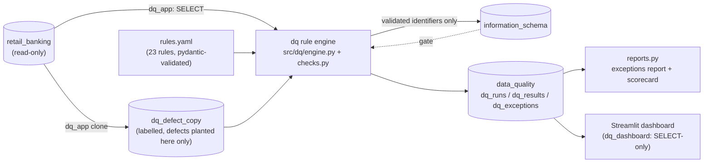

# data-quality-framework

**Problem**: a bank needs to know, continuously and automatically, whether
its data is trustworthy — not find out the hard way when a report is
wrong. **Approach**: a config-driven rule engine (23 rules, 6 check types)
that runs against the same Berka banking data loaded by the sibling
`retail-banking-analytics` project, scores every rule, and proves itself
by catching errors deliberately planted into a labelled copy.
**Found**: 22/23 rules pass against the real data; the one failure
(transaction type codes) independently rediscovers a real data anomaly
the sibling project found by hand — two different analyses of the same
raw data landed on the same number. Full write-up:
[docs/traceability_matrix.md](docs/traceability_matrix.md) and
[docs/interview_notes.md](docs/interview_notes.md).

## Architecture

## Quickstart

1. Make sure `retail-banking-analytics`'s loader has already populated
   `retail_banking` (this project reads it, never writes it).
2. Create the two new schemas and two users: edit the passwords in
   `../_setup/create_dq_users.sql` (shared with the sibling project,
   outside both repos) and run it as root — see
   [SECURITY.md](SECURITY.md) for what the grants mean. Then copy
   `.env.example` to `.env` and fill in the passwords you chose.
3. Run `./scripts/setup.ps1` — creates the venv, installs dependencies,
   applies `sql/results_schema.sql`.
4. Run `./scripts/run.ps1` — runs all 23 rules, writes the exceptions
   report + scorecard, runs the pytest suite.
5. `python -m dq inject-defects` then `python -m dq run --config
   rules.yaml --source defect_copy --report` to see the framework catch
   planted errors, and `streamlit run src/dq/dashboard.py` for the
   dashboard (scorecard, drill-down, trend across runs).

## Repository layout

| Path | Contents |
|---|---|
| `rules.yaml` | 23 rules, every threshold calibrated against real data |
| `sql/results_schema.sql` | `dq_runs` / `dq_results` / `dq_exceptions` |
| `src/dq/config.py` | pydantic schema for rules.yaml (6 check types) |
| `src/dq/validation.py` | the information_schema gate every identifier passes through |
| `src/dq/checks.py` | the six check types |
| `src/dq/engine.py` + `cli.py` | orchestration + `python -m dq run/report/inject-defects` |
| `src/dq/defect_injection.py` | clones + plants documented errors into `dq_defect_copy` |
| `src/dq/dashboard.py` | Streamlit dashboard (read-only `dq_dashboard` user) |
| `tests/` | pytest suite — one test per check type, config validation, identifier validation |
| `exports/scorecard.csv` | aggregate pass rates (committed — no record-level data) |
| `exceptions_reports/` | per-run failing-record drill-down (gitignored — record-level) |
| `docs/traceability_matrix.md` | business requirement → rule → check → result |
| `docs/interview_notes.md` | design decisions, trade-offs, Q&A |
| `SECURITY.md` | credential handling, SQL-injection controls, least-privilege users |

## Tech stack

Python 3.11, pandas, SQLAlchemy, pydantic, PyYAML, MySQL 8, Streamlit,
pytest, ruff, bandit, pip-audit.
